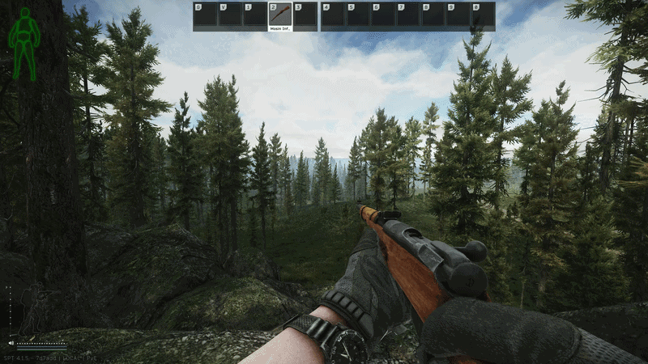

# Catch Chambered Rounds

[)](https://github.com/Tosox/SPT-CatchChamberedRounds/releases) [)](https://github.com/Tosox/SPT-CatchChamberedRounds/releases/latest)

## 📜 Description

**Catch Chambered Rounds** is a mod for *Single Player Tarkov* that stops the chambered round from being thrown on the floor when you reload a weapon with an internal magazine, stowing it in your gear instead.

## ✨ Features

* Keeps the chambered round when reloading rifles that have to open the bolt, such as the Mosin
* Plays the vanilla catch animation, spliced into the reload
* Lets a quick reload skip the catch and reload normally
* Refuses reloads that cannot add any rounds

## 📁 Installation

* Download the latest release
* Copy the `BepInEx` folder into your SPT folder
* Start the game

## ⚙️ Configuration

| Setting | Default | Description |
| --- | --- | --- |
| `Enabled` | `true` | Untick to disable catching the chambered round |
| `Play Catch Animation` | `true` | Pull the round out with a catch animation instead of stowing it silently |
| `Quick Reload Skips the Catch` | `true` | Let a quick reload skip the catch and reload normally |
| `Invert Reload Keys` | `false` | Swap the keys, so the normal reload drops the round and quick reload catches it |
| `Block Pointless Reloads` | `true` | Refuse a reload that cannot add any rounds |
| `Verbose Logging` | `false` | Write additional details to the log for troubleshooting |

## 🤝 Fika

When playing with **Fika**, every client in the raid, **including the headless client**, should run the same version of this mod, otherwise you will run into syncing issues.
Hosts can enforce this by adding the plugin GUID to `client.mods.required` in the Fika server config, so mismatched clients are rejected when joining instead of silently desyncing:

```jsonc
"required": [ "de.tosox.catchchamberedrounds" ]
```

## 📝 Changelog

You can check out the latest changes in [`CHANGELOG.md`](CHANGELOG.md).

## 📷 Preview



## 📄 License

Distributed under the MIT License. See `LICENSE` for more information.
